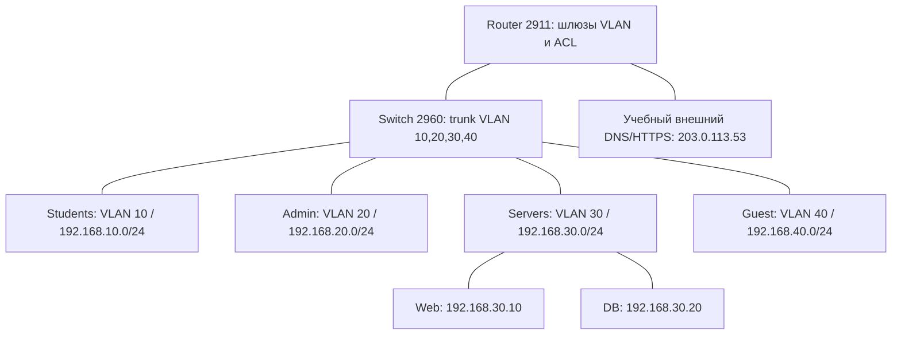

# Работа 5. Сетевая безопасность

Егоров, группа 16М-нф26.

## Зоны и потоки



Адреса взяты из [network_plan.csv](data/network_plan.csv). Внешний DNS/HTTPS — отдельный учебный сервер со шлюзом 203.0.113.1. Во внутренних подсетях шлюз — .1, ПК — .10.

| Источник → назначение | Протокол / порт | Решение | Назначение или причина запрета; механизм |
|---|---|---|---|
| Students → Web | TCP/443 | ALLOW | LMS; ACL разрешает только нужный порт |
| Students → DNS | UDP/53 | ALLOW | Разрешение имён; ACL на адрес DNS |
| Students → DB | TCP/5432 | DENY | Студент работает через LMS, прямой доступ к базе не нужен; ACL |
| Students → Admin | TCP/3389 | DENY | Удалённое управление чужой рабочей зоной не требуется; VLAN и ACL |
| Admin → Web | TCP/443 | ALLOW | Внутренний сервис; ACL |
| Admin → DB | TCP/5432 | ALLOW | Согласованное администрирование; ACL и контроль входа в БД |
| Web в Servers → DB | TCP/5432 | ALLOW | Работа приложения с данными; трафик внутри серверного VLAN |
| Servers → DNS | UDP/53 | ALLOW | Разрешение имён; ACL |
| Guest → внешний HTTPS | TCP/443 | ALLOW | Доступ к учебному внешнему сайту; ACL |
| Guest → внешний DNS | UDP/53 | ALLOW | Разрешение имён для внешнего сайта; ACL |
| Guest → Web | TCP/443 | DENY | Гостям не нужен внутренний сервис; VLAN и ACL |
| Guest → DB | TCP/5432 | DENY | Гостям не нужны внутренние данные; VLAN и ACL |

Остальные обращения через маршрутизатор запрещены. Для ответов есть отдельные правила; `established` проверяет TCP ACK/RST. Web и DB в одном VLAN, поэтому ACL маршрутизатора не проверяет их обмен.

## Настройка и проверка сети

Сеть собрана в Cisco Packet Tracer 9.0.1: [campus_network.pkt](campus_network.pkt), [топология](screenshots/topology.png). Настройки — [маршрутизатор](router.txt) и [коммутатор](switch.txt). На коммутаторе Fa0/1 соединяется с Gi0/0 маршрутизатора; Fa0/2 — Students, Fa0/3 — Admin, Fa0/4 — Guest, Fa0/5 — Web, Fa0/6 — DB. Внешний сервер соединяется с Gi0/1 маршрутизатора.

| Тест | Ожидание | Факт | Вывод |
|---|---|---|---|
| Students → Web, TCP/443 | ALLOW | [Страница открылась](screenshots/students-https.png) | HTTPS доступен |
| Students → DB, TCP/5432 | DENY | [На маршрутизаторе STUDENTS_IN: deny ip any any](screenshots/students-db-denied.png) | Прямой доступ заблокирован |
| Admin → Web, TCP/443 | ALLOW | [Страница открылась](screenshots/admin-https.png) | Внутренний сервис доступен |
| Admin → DB, TCP/5432 | ACL пропускает | [Пакет дошёл до DB; получен RST+ACK](screenshots/admin-db-port.png) | Сетевой доступ разрешён, службы PostgreSQL в модели нет |
| Guest → Web, TCP/443 | DENY | [Request Timeout](screenshots/guest-internal-denied.png) | Внутренний сайт недоступен |
| Guest → внешний сервер, TCP/443 | ALLOW | [Страница открылась](screenshots/guest-external-https.png) | Внешний учебный сайт доступен |

Проверки: HTTPS — браузерами узлов, TCP/5432 — двумя Complex PDU с исходными портами 50001 и 50002. Обе PDU получили Failed, но причины разные: ACL остановил студента; пакет администратора дошёл до DB, где нет PostgreSQL. Подключение к базе не проверено.

## Анализ трафика

В учебном `data/synthetic_traffic.pcap` 7 искусственных кадров: DNS, установление TCP и запрос/ответ HTTP. Клиент 192.0.2.10 запрашивает example.org у DNS 192.0.2.53, получает 198.51.100.20 и открывает `/demo`. Использованы фильтры `dns`, `tcp`, `http`, `ip.addr == 192.0.2.10`. TLS в этом файле нет.

Локальный опыт с `study.example`: [local_dns_tls.pcap](local_dns_tls.pcap), 23 пакета. Интерфейс NPF_Loopback, фильтр `udp port 53535 or tcp port 8443`. Клиент проверил сертификат по отдельному файлу доверия. [Результат](capture_result.txt), [список пакетов](packets.csv).

| Протокол | Адреса и порты в захвате | Назначение и наблюдение |
|---|---|---|
| DNS | 127.0.0.1:54766 → 127.0.0.1:53535 и ответ | Пакеты 1–2: запрос A study.example, ответ 127.0.0.1 |
| TCP | 127.0.0.1:9645 ↔ 127.0.0.1:8443 | Пакеты 3–5: SYN, SYN/ACK, ACK |
| TLS | То же TCP-соединение | Client Hello в пакете 6, Server Hello в 8, затем зашифрованные записи |

Клиент получил HTTP 200 и 71 байт страницы. Использованы TLS 1.3 и TLS_AES_256_GCM_SHA384. Версия TLS 1.3 указана в supported_versions; TLS 1.2 в поле Version оставлена для совместимости.

Скриншоты: [DNS](screenshots/wireshark-dns.png), [TCP](screenshots/wireshark-tcp.png), [TLS](screenshots/wireshark-tls.png).

Для открытия с нужным распознаванием портов:

```text
wireshark -r local_dns_tls.pcap -d udp.port==53535,dns -d tcp.port==8443,tls
```

### Вывод

В DNS видно имя сайта, TCP устанавливает соединение, TLS скрывает содержимое обмена. Адреса, размеры и время пакетов остаются видны. В учебном HTTP запрос читается, в локальном TLS текст страницы без ключей не виден. VLAN разделяет зоны, ACL ограничивает обращения. VPN защищает удалённый канал, IDS замечает подозрительные события, IPS может их блокировать. Права в приложении всё равно нужно проверять.
