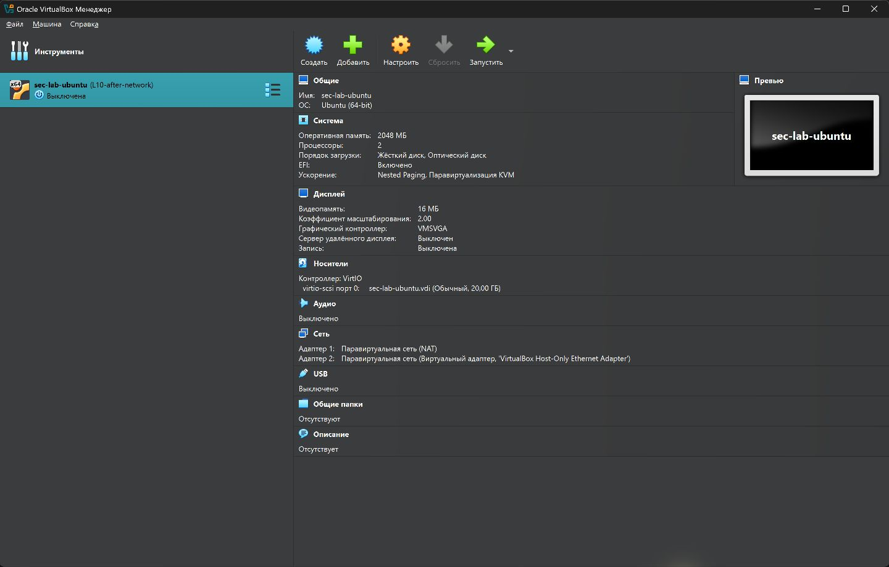
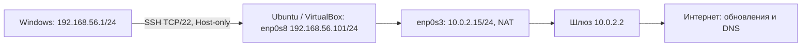
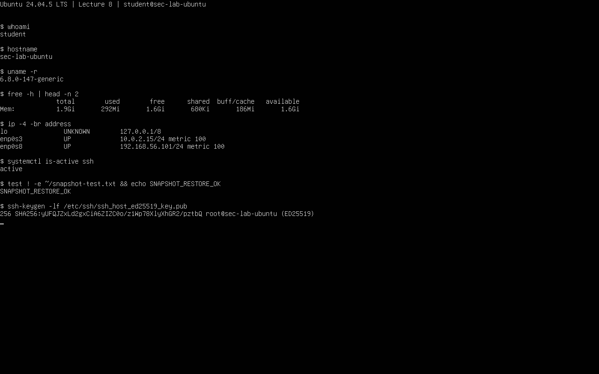

# Лекция 8. Учебный стенд

Егоров, группа 16М-нф26. 29.10.2026.

## 8.1. Виртуальная машина

Хост — Windows 11 Home, VirtualBox 7.1.18. ВМ — Ubuntu 24.04.5 LTS без рабочего стола, ядро `6.8.0-147-generic`, пользователь `student`, имя `sec-lab-ubuntu`. Ресурсы: 2 CPU, 2048 МБ RAM, динамический VDI до 20 ГБ. Ubuntu показывает диск `sda` 20 ГБ и около 1,9 GiB памяти.

Использован готовый официальный образ `ubuntu-24.04-minimal-cloudimg-amd64.img`, выпуск 20261027, преобразованный в VDI. Установка через мастер ISO не выполнялась. Образ и SHA-256 взяты с [сервера Ubuntu](https://cloud-images.ubuntu.com/minimal/releases/noble/release-20261027/). Сумма совпала:

```text
3839f148c5a3b4a736e7dbb0af75594743fa5ebee2a202424ba1a32e5d3b5d2c
```

[Команды и вывод](results/01_environment.txt): `whoami`, `hostnamectl`, `uname -r`, `lsblk`, `free -h`. Динамический VDI растёт по мере записи до 20 ГБ. При заполнении диска хоста запись в ВМ может остановиться. После подготовки служебный диск cloud-init отключён.



## 8.2. Сеть



| Интерфейс | Назначение | Маршрут |
|---|---|---|
| `enp0s3` | NAT, исходящий доступ | По умолчанию через `10.0.2.2`; DNS `10.0.2.3` |
| `enp0s8` | Host-only, доступ с хоста | Локальная сеть `192.168.56.0/24`, без второго шлюза по умолчанию |
| `lo` | Обращение к самой Ubuntu | `127.0.0.1/8` |

Команды: `ip -br address`, `ip route`, `resolvectl status`, `ping -c 3 -W 3 1.1.1.1`, `getent hosts ubuntu.com`. Ping — 3 ответа из 3, DNS вернул адрес. С Windows до Host-only адреса — 2 ответа из 2. [Вывод Ubuntu](results/02_network.txt), [Windows](results/04_host_ssh.txt), [netplan](results/08_network_configuration.txt).

## 8.3. SSH

После обновления списка пакетов установлены OpenSSH Server и нужные утилиты. Служба `ssh` — `active`, слушает TCP/22. [Установка](results/00_packages.txt), [служба и журнал](results/03_ssh.txt).

Ключ сервера получен через последовательную консоль VirtualBox для проверки SSH. Отпечаток:

```text
SHA256:yUFQJZxLd2gxCiA6ZIZC0o/z1Wp78XlyXhGR2/pztbQ
```

На Windows ключ сервера добавлен в отдельный `known_hosts`. Подключение использовало `StrictHostKeyChecking=yes` и учебный ключ пользователя. `hostname` и `whoami` вернули `sec-lab-ubuntu` и `student`; журнал — `Accepted publickey` с `192.168.56.1`. [Команда и результат](results/04_host_ssh.txt). Пароли и приватные ключи не приложены.

## 8.4. Снимок и контроль

Создан снимок выключенной ВМ `L08-clean-base`. После запуска создан `~/snapshot-test.txt`, затем выполнен откат при выключенной ВМ. Результат — `SNAPSHOT_RESTORE_OK`: файл исчез, SSH `active`, оба IP сохранились. [До отката](results/05_snapshot_before.txt), [после](results/06_snapshot_after.txt), [снимки](results/snapshots.txt).

Готовый скрипт преподавателя: `python3 scripts/check_lab_evidence.py data/example_checks.csv`. В **синтетическом примере** 8 проверок: 6 PASS, 2 REVIEW — не проверены ключ сервера и откат.

В [таблицу стенда](data/actual_checks.csv) внесены реальные результаты, включая ключ и откат: 8 PASS, 0 REVIEW. [Оба вывода](results/07_csv_checks.txt). Скрипт проверяет записи CSV, а не саму Ubuntu.



## Диагностика

Сначала интерфейсы были `DOWN`, `networkctl list` показывал `unmanaged`. Команда `cat /etc/netplan/*` подтвердила отсутствие настроек. В `/etc/netplan/50-lab.yaml` задан DHCP обоим адаптерам без маршрутов и DNS от Host-only. После `sudo netplan generate` и `sudo netplan apply` появились IP, маршрут NAT и SSH. Файл настроек приложен выше.

## Ответы на вопросы

1. NAT даёт исходящий доступ через хост. Host-only связывает хост и ВМ. Bridge подключает ВМ прямо к физической сети; здесь он не использовался.
2. `active` означает, что служба работает. Доступ с Windows подтверждают вход и журнал SSH.
3. Отпечаток позволяет проверить, что сервер не подменён.
4. ВМ и её снимки могут потеряться вместе с диском. Резервную копию хранят отдельно.
5. Если связь по IP работает, а `getent` не возвращает адрес, нужно проверить DNS. Неудачный ping может означать блокировку ICMP.

Стенд доступен по Host-only, исходящий доступ и восстановление снимка проверены.
