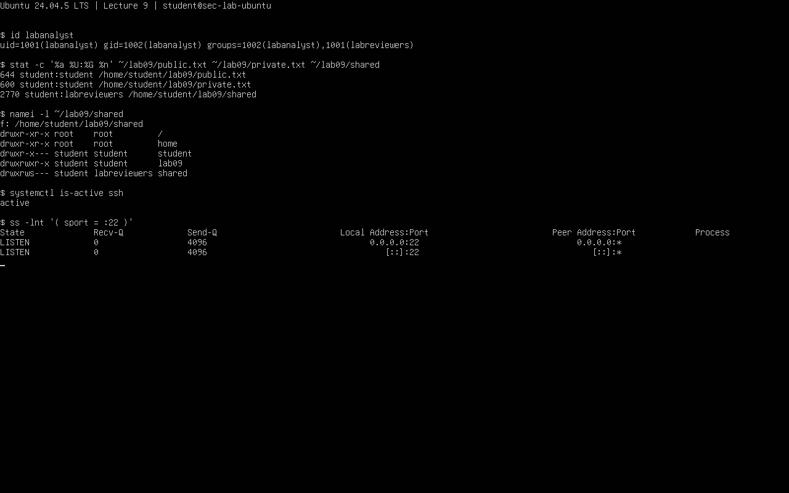

# Лекция 9. Пользователи, права и службы Linux

Егоров, группа 16М-нф26. 29.10.2026. Ubuntu 24.04.5 LTS, ВМ `sec-lab-ubuntu`; сохранён снимок `L08-clean-base`.

## 9.1. Пользователи и группы

Команды: `whoami`, `id`, `groups`, `getent passwd "$USER"`, `getent group sudo`, `sudo -l`. У `student` UID/GID 1000/1000 и группа `sudo`. Созданы `labreviewers` и пользователь `labanalyst`, добавленный в группу командой `sudo usermod -aG labreviewers labanalyst`. [Вывод](results/01_users.txt).

```text
uid=1001(labanalyst) gid=1002(labanalyst) groups=1002(labanalyst),1001(labreviewers)
```

UID — номер пользователя, GID — группы. `sudo -u labanalyst id` показал UID не 0. У нового пользователя нет sudo, пароль не задан: `passwd -S` показывает `L` (заблокирован).

`/etc/passwd` хранит имя, UID/GID, домашнюю папку и оболочку. `/etc/shadow` содержит закрытые сведения о паролях; они не приложены. `getent` читает настроенные источники аккаунтов. `sudo` запускает отдельную команду от другого пользователя, обычно root. Вход root даёт сессию с полными правами.

## 9.2. Права доступа

Команды выполнены в `~/lab09`: `umask`, `chmod`, `stat`, `chgrp`, `ls -ld`, `namei -l`. [Начальная проверка](results/02_permissions.txt), [установка SGID](results/05_sgid.txt).

| Объект | Итоговый режим | Владелец:группа | Смысл |
|---|---|---|---|
| `public.txt` | 644 | student:student | Владелец читает/пишет, остальные читают |
| `private.txt` | 600 | student:student | Только владелец читает/пишет |
| `shared` | 2770 | student:labreviewers | Доступ владельцу и группе; SGID наследует группу для новых объектов |
| `/home/student` | 750 | student:student | Посторонним нет прохода |

`umask` — `0002`, она убирает права при создании файла. `chmod` меняет права готового файла. Для файла `r/w/x` — чтение, запись, запуск; для папки — просмотр имён, изменение её содержимого и проход внутрь.

`chmod 2770 shared` оставил 770: `student` не входит в `labreviewers`, SGID сброшен. `sudo chmod 2770` установил 2770, `ls -ld` показал `s`. `chown` меняет владельца, `chgrp` — группу, `chmod` — права.

`sudo -u labanalyst touch "$HOME/lab09/shared/from-analyst"` вернул `Permission denied`. По `namei -l` причина — закрытый проход через `/home/student`. Домашняя папка и `/srv` оставлены как были. Необязательных `getfacl` и `setfacl` нет, ACL не проверялись.

## 9.3. Процессы, службы и журнал

Выполнены `ps -eo pid,ppid,user,comm`, `systemctl status ssh --no-pager`, `sudo ss -lntp` и `sudo journalctl -u ssh --since '30 minutes ago' --no-pager`. SSH работает и слушает TCP/22; в журнале есть собственное подключение с `192.168.56.1`. [Вывод команд](results/03_services.txt).

PID — номер процесса, PPID — его родителя, `user` — владелец. Unit — объект systemd, например служба `ssh.service`. `enabled` — включён автозапуск, `active` — служба работает сейчас.

Учебный `sleep 120` проверен через `ps` и остановлен по сохранённому PID: `kill "$pid"`. Код `wait` 143 означает остановку по SIGTERM.



## 9.4. Аудит учебного CSV

Готовый скрипт преподавателя `python3 scripts/audit_permissions.py data/permissions.csv` проверяет **синтетический CSV**, не меняя реальную систему. [Вывод до и после](results/04_csv_audit.txt).

| Строка | Замечание в модели | Изменение в копии |
|---|---|---|
| P01 | Чувствительный файл читается всеми | 0644 → 0600 |
| P03 | Резервная копия доступна для чтения/записи посторонним | 0666 → 0600 |
| P04 | Каталог доступен всем для записи | 0777 → 2770 |
| P05 | Не заполнен владелец | Указан `app` |

После исправления копии [permissions_fixed.csv](data/permissions_fixed.csv) получено 8 PASS и 0 REVIEW вместо 4 PASS и 4 REVIEW. Оригинал сохранён. Результат относится только к таблице: скрипт не проверяет ACL и родительские папки. P01 помечен из-за `sensitive=yes`; режим 644 у реального `sshd_config` сам по себе не обязательно ошибка.

На ВМ проверены пользователи, права, отказ в доступе, SSH и остановка процесса. CSV исправлен отдельно. Следующая работа — адреса, маршруты и соединения.
