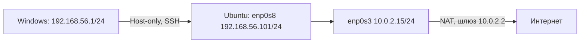
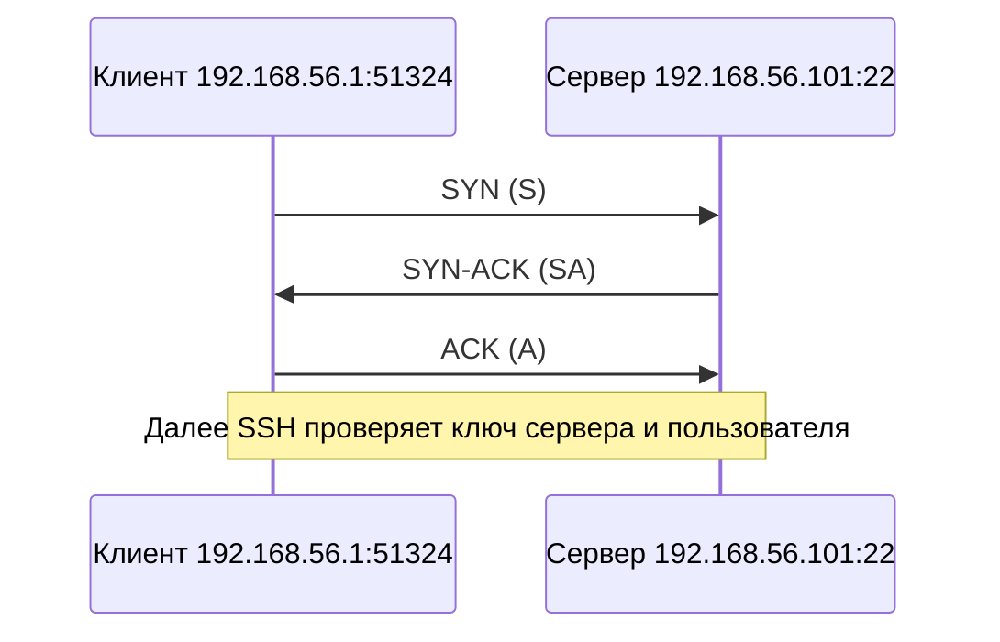
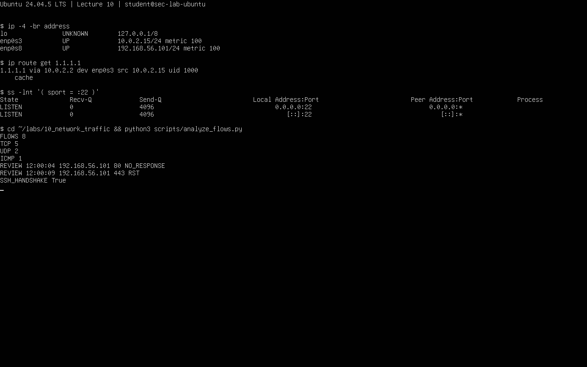

# Лекция 10. Сеть и трафик

Егоров, группа 16М-нф26. 29.10.2026. Windows 11, VirtualBox, Ubuntu 24.04.5 LTS. Снимки: до работы `L10-before-network`, после `L10-after-network`. Python-скрипты взяты из комплекта преподавателя.

## 10.1. Интерфейсы и маршруты

Цель — найти путь к хосту и в интернет. Команды в Ubuntu: `ip -br address`, `ip route`, `ip -br link`, `hostname -I`, `ip route get 1.1.1.1`. [Результат](results/01_interfaces.txt).



| Интерфейс | IPv4/префикс | Сеть | Роль |
|---|---|---|---|
| enp0s3 | 10.0.2.15/24 | 10.0.2.0/24 | NAT, маршрут по умолчанию |
| enp0s8 | 192.168.56.101/24 | 192.168.56.0/24 | Связь с хостом |
| lo | 127.0.0.1/8 | 127.0.0.0/8 | Локальные обращения |

Интерфейс — подключение к сети, маршрут — путь пакета. `dev` — интерфейс, `via` — следующий узел, `src` — адрес отправителя, `metric` — приоритет пути. `UP` означает включённый интерфейс. `/24` — маска 255.255.255.0.

`ip route get 1.1.1.1` выбрал шлюз `10.0.2.2` через `enp0s3`, но не проверял доставку. NAT даёт исходящий доступ; Host-only нужен для связи с Windows.

`python3 scripts/analyze_interfaces.py` разобрал **учебный CSV**. Его три IPv4-подсети совпали со стендом. Реальные интерфейсы скрипт не читает.

## 10.2. Протоколы и сокеты

Цель — отличить ожидание подключения от готового соединения. `ss -tuln` и `sudo ss -lntp` показали TCP/22 на `0.0.0.0` и `[::]`. `LISTEN` — ожидание подключения, локальный адрес — где слушает программа, PID — номер её процесса. UDP принимает отдельные сообщения без рукопожатия. [Вывод](results/02_sockets.txt).

`python3 scripts/analyze_flows.py` обработал **синтетический flows.csv**: 8 событий, TCP — 5, UDP — 2, ICMP — 1; `SSH_HANDSHAKE True`.



| Событие CSV | Объяснение | Следующая проверка |
|---|---|---|
| TCP/80, NO_RESPONSE | Ответ вовремя не получен; возможны фильтрация, недоступный узел или потеря пакетов | Маршрут, состояние узла, сокет, правила |
| TCP/443, RST | Соединение явно отвергнуто; возможен закрытый порт или активное отклонение | `ss`, состояние службы и firewall |

TCP передаёт поток через соединение, UDP — отдельные сообщения, ICMP — служебные сообщения, например ping. У ICMP нет портов, нули в CSV условные. TCP-рукопожатие ещё не означает вход по SSH. Необязательный tcpdump не выполнялся.



## 10.3. DNS

Цель — разделить проверку имени и связи по IP. Команды: `resolvectl status`, `getent ahostsv4 example.com`, `ip route`, `ping -c 2 -W 3 1.1.1.1`. DNS-сервер NAT — `10.0.2.3`; имя `example.com` разрешилось, ping получил ответы. [Вывод и анализ CSV](results/03_dns.txt).

`python3 scripts/analyze_dns.py` разобрал **4 учебные записи**. A — IPv4, AAAA — IPv6, CNAME — другое имя, TTL — срок хранения ответа в кеше. У `lab.example.test` A `192.168.56.101`, TTL 300 и пустой AAAA с NOERROR; у `missing.example.test` — NXDOMAIN; у `docs.example.test` — CNAME, TTL 120. NXDOMAIN означает, что имени нет. Пустой AAAA с NOERROR означает только отсутствие IPv6-записи.

```text
Имя не открывается
├─ getent не возвращает адрес → проверить DNS через resolvectl
└─ адрес получен
   ├─ ip route get адрес не находит путь → проверить маршруты и адаптер
   └─ путь есть → проверить TCP-порт и ответ приложения
      ├─ timeout → проверить фильтрацию, узел и обратный путь
      └─ ответ HTTP → разбирать код и путь запроса
```

Возможные причины: DNS, маршрут, служба или фильтрация порта. Ответ DNS не гарантирует работу сервера, отказ ping не исключает работу HTTP.

## 10.4. Фильтрация

Цель — проверить фильтрацию и предложить правила SSH. `sudo ufw status verbose` показал UFW **inactive**, `ss` — SSH на TCP/22. Настройки не менялись. [Вывод](results/04_firewall.txt).

`python3 scripts/check_firewall.py` проверил **4 учебных правила**: SSH из `192.168.56.0/24` разрешён, затем для остальных запрещён; входящий TCP/80 запрещён; исходящий UDP/53 разрешён. Результат: `SSH_RESTRICTED True`, `ORDER_MATTERS True`. Скрипт не применяет правила и не повторяет всю работу UFW/iptables. Например, он не учитывает DNS по TCP/53.

Предлагаемая политика: SSH только с `192.168.56.1` через Host-only, остальные новые подключения к TCP/22 запрещены. Нужный исходящий доступ и ответы сохраняются. Если действует первое совпавшее правило, частное разрешение ставят перед общим запретом.

План проверки: снимок и консоль VirtualBox → изменения → новый вход во второй сессии и журнал. Первую сессию не закрывать. При ошибке вернуть настройки через консоль. План не применялся.

Фильтр пропускает пакет, слушающий сокет принимает соединение, SSH проверяет ключи и пользователя. Для успешного входа нужны все три шага.
