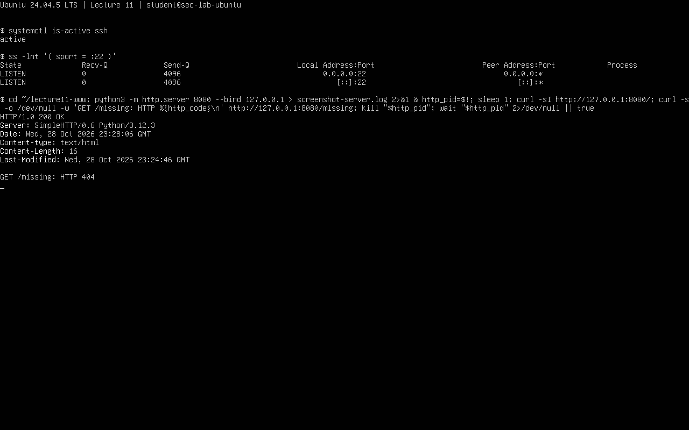
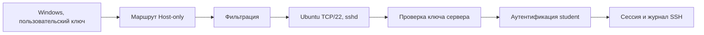

# Лекция 11. Сетевые службы Ubuntu

Егоров, группа 16М-нф26. 29.10.2026. Windows 11, Ubuntu 24.04.5 LTS в VirtualBox. Host-only: Ubuntu `192.168.56.101/24`, хост `192.168.56.1/24`. Скрипты CSV взяты из комплекта преподавателя.

## 11.1. Службы и сокеты

Цель — связать службу, процесс и порт. Команды: `hostnamectl`, `ip -br a`, `ip route`, `systemctl is-active ssh`, `systemctl is-enabled ssh`, `sudo ss -lntup`, `ps` для MainPID. SSH — `active`, `enabled`; TCP/22 слушает `sshd`, PID в этом запуске — 428. [Вывод](results/01_services.txt).

`127.0.0.1` — сама ВМ, `0.0.0.0` — все её IPv4-интерфейсы. Host-only IP ограничивает интерфейс, но права входа и фильтрацию проверяют отдельно. `LISTEN` означает ожидание подключения; дальше нужен пробный вход.

`python3 scripts/audit_services.py` проверяет **синтетический services.csv**:

| Объект | Исходные данные и правило | Риск | Рекомендация и проверка |
|---|---|---|---|
| admin-ui | enabled=no, 0.0.0.0:9090 → verify-disabled | Отключённый автозапуск не гарантирует остановку | Проверить `systemctl` и `ss`; при необходимости привязать к loopback |
| metrics | 0.0.0.0:9100 вместо loopback | Метрики могут быть доступны лишним интерфейсам | Ограничить привязку; повторить проверку сокета и доступности |
| legacy-telnet | enabled=no, 0.0.0.0:23 → verify-disabled | Возможно, небезопасная служба всё ещё запущена | Проверить процесс и порт; ненужную службу остановить по плану |

Получено 3 REVIEW. Строки ssh/nginx с `expected=hostonly` тоже требуют проверки адресов, хотя скрипт их не отметил. CSV не описывает установленные службы ВМ и не заменяет их проверку.

## 11.2. HTTP

Цель — сравнить ответы HTTP. В `~/lecture11-www/index.html` записано `Lecture 11 demo`. Сервер: `python3 -m http.server 8080 --bind 127.0.0.1`. Запросы — из второй сессии Ubuntu. [Вывод GET/HEAD/404](results/02_http.txt).

| Команда | Фактический результат | Объяснение |
|---|---|---|
| `curl -i http://127.0.0.1:8080/` | 200 OK, текст страницы | Сервер обработал GET и вернул тело |
| `curl -I http://127.0.0.1:8080/` | 200 OK, заголовки | HEAD возвращает метаданные без тела |
| `curl -i http://127.0.0.1:8080/missing` | 404 File not found | HTTP работает, запрошенный ресурс отсутствует |

`Server` — программа сервера, `Content-Type` — тип содержимого, `Content-Length` — размер в байтах. HEAD возвращает заголовки без тела, но указывает размер ответа GET. Код 4xx — ответ HTTP с ошибкой запроса или доступа.

`python3 scripts/check_http.py` разобрал **6 учебных случаев**, включая 3 ошибки: 403 — доступ запрещён, 404 — нет ресурса, 405 — метод запрещён. На локальном сервере проверены 200 и 404; 403/405 взяты из CSV. Учебный `http.server` запущен только локально. После проверки процесс остановлен по PID, порт 8080 больше не слушает: [вывод](results/05_server_stop.txt).

## 11.3. SSH и аутентификация

Цель — проверить настройки и вход SSH. Команды: `systemctl status ssh`, `sudo sshd -T`, `sudo sshd -t`, `journalctl -u ssh`. Результат: `SSHD_SYNTAX_OK`, в журнале `Accepted publickey` с `192.168.56.1`. [Вывод](results/03_ssh.txt).

| Параметр | Фактическая Ubuntu |
|---|---|
| PermitRootLogin | without-password |
| PasswordAuthentication | yes |
| PubkeyAuthentication | yes |
| MaxAuthTries | 6 |
| X11Forwarding | yes |

`without-password` запрещает root вход по паролю, но не все способы входа. В образе root также заблокирован. Настройки не менялись.

Отдельно `python3 scripts/audit_ssh.py` выявил 3 расхождения **в учебной таблице**:

| Параметр | CSV → целевая политика | Риск и проверка после планируемого изменения |
|---|---|---|
| PermitRootLogin | yes → no | Прямой вход root; проверить `sshd -T` и разрешённый вход обычного пользователя |
| PasswordAuthentication | yes → no | Возможность подбора пароля; сначала подтвердить вход ключом в новой сессии |
| MaxAuthTries | 6 → 3 | Больше попыток за соединение; проверить эффективную настройку и журнал |

Целевые значения — пример из задания. План: снимок и копия настроек → запасная консоль и сессия → проверка входа ключом → изменение → `sshd -t` → перечитать настройки → проверить новый вход и журнал. При ошибке вернуть настройки через консоль. План не применялся.

Ключ сервера нужен клиенту для проверки сервера, ключ пользователя — серверу для проверки пользователя. Перед отключением пароля нужно проверить вход ключом.

## 11.4. Диагностика

Цель — найти шаг, на котором возникает ошибка: клиент → DNS/адрес → маршрут → фильтр → сокет → HTTP/SSH → журнал. [Проверки стенда](results/04_checks.txt).

| Гипотеза | Команда | Фактический результат | Интерпретация и предел | Следующий шаг |
|---|---|---|---|---|
| Есть маршрут к хосту | `ip route get 192.168.56.1` | enp0s8, src 192.168.56.101 | Маршрут выбран, доставка ещё не доказана | Проверить SSH с Windows |
| Службы слушают | `sudo ss -lntp` | TCP/22 и локальный 127.0.0.1:8080 | Видны сокеты, но не успешный запрос | Сделать запрос/вход |
| HTTP отвечает | `curl -i http://127.0.0.1:8080/` | 200 OK и содержимое | Проверена только локальная страница `/` | Сопоставить с server.log |
| Запрос попал в журнал | `cat ~/lecture11-www/server.log` | GET/HEAD 200 и GET /missing 404 | Подтверждены эти запросы, не все ресурсы | Разбирать конкретный код и путь |

`python3 scripts/review_checks.py`: **2 GAP из 8 учебных проверок**. C05 — ошибка `/health`, нужно проверить путь и обработчик. C07 — нет связи по request-id, нужно проверить запись номера запроса в журналы. Это замечания CSV, не ошибки нашей ВМ.

Разбор четырёх ошибок из презентации:

| Симптом | Уровень и гипотеза | Проверка | Ожидаемый признак | Ограничение |
|---|---|---|---|---|
| Имя не разрешается | DNS: сервер/запись недоступны | `getent hosts имя`, `resolvectl status` | Нет адреса, ошибка DNS или неверный сервер | Приложение может использовать другой DNS/кеш |
| Connection refused на 22 | TCP: нет слушателя или активный отказ | `systemctl status ssh`, `sudo ss -lntp` на своей ВМ | Остановленная служба или отсутствие нужной привязки | Отказ возможен и от фильтра; пароль ещё не проверялся |
| Connection timed out | Сеть/фильтрация: ответа нет | `ip -br a`, `ip route get адрес`, проверка ВМ и правил | Неверный путь, выключенный адаптер либо потеря ответа | Тайм-аут сам по себе не называет виновника |
| HTTP 404 | Приложение: неверный путь | `curl -i URL`, журнал сервера, проверка файла | Ответ 404 при работающем HTTP | Не доказывает неисправность всех ресурсов сервиса |

`active` и `LISTEN` показывают работу службы и порта. Для входа ещё нужны маршрут и проверка пользователя. HTTP 404 означает, что сервер ответил, но не нашёл ресурс.
