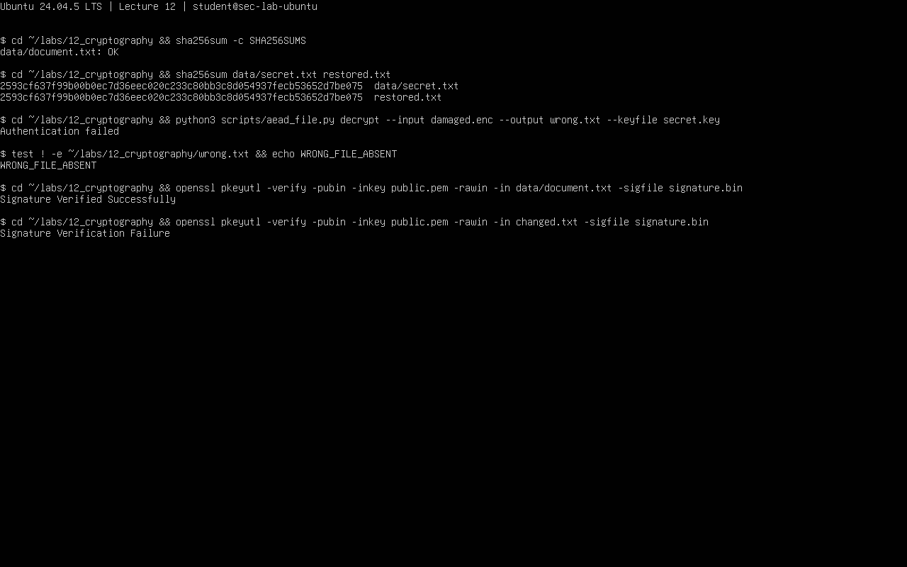

# Лекция 12. Криптографические проверки

Егоров, группа 16М-нф26. 29.10.2026. Ubuntu 24.04.5 LTS, Python 3.12.3, cryptography 41.0.7 из пакетов Ubuntu, OpenSSL 3.0.13 ([вывод](results/01_hash.txt)). Опыты выполнены в Ubuntu на учебных файлах готовыми скриптами преподавателя и командами OpenSSL.

## 12.1. SHA-256

Команды: `python3 scripts/hash_experiment.py`, `sha256sum data/document.txt > SHA256SUMS`, `sha256sum -c SHA256SUMS`. Результаты: `DIFFERENT True`, исходный файл — `data/document.txt: OK`. После изменения одного байта копии прежний эталон дал `FAILED`, код 1. [Вывод](results/01_hash.txt).

SHA-256 исходного документа:

```text
08d76effa0bbf1dcc2d7b14b7beb1d483b5d9e1101a4c30eeae2df1122a2697a
```

Хеш зависит от содержимого файла. Эталон должен быть доверенным: вместе с файлом могут подменить и его сумму. SHA-256 не скрывает данные и не доказывает авторство.

## 12.2. AES-256-GCM

Учебный `data/secret.txt` зашифрован скриптом `aead_file.py`, затем расшифрован в `restored.txt`. Хеши исходного и восстановленного файлов совпали:

```text
2593cf637f99b00b0ec7d36eec020c233c80bb3c8d054937fecb53652d7be075
```

`python3 scripts/tamper.py secret.enc damaged.enc` повредил копию. Расшифровка вернула `Authentication failed`, код 1. `wrong.txt` не создан (`WRONG_FILE_ABSENT`). Права ключа — 600. [Команды и вывод](results/02_aes.txt).

AES-GCM шифрует данные и обнаруживает подмену. Скрипт использует секретный ключ, случайный nonce из 12 байт и AAD `lecture12-v1` — открытые данные с проверкой целостности. Nonce не скрывают, но не повторяют с тем же ключом: повтор нарушает защиту GCM. Ключ нужно хранить отдельно; его кража лишает данные защиты.

Приложены [шифротекст](results/secret.enc), [повреждённая копия](results/damaged.enc), [восстановленный текст](results/restored.txt). Ключ не приложен, поэтому эти файлы без него не расшифровать. Повторить опыт можно с новым ключом и новыми именами файлов.

## 12.3. Ed25519

Созданы приватный и публичный ключи, права приватного — 600. Подпись: `openssl pkeyutl -sign ... -rawin`. Исходный документ прошёл проверку: `Signature Verified Successfully`. Копия с добавленным `modified` не прошла: `Signature Verification Failure`, код 1. [Полные команды](results/03_signature.txt).

Приложены [публичный ключ](results/public.pem), [подпись](results/signature.bin) и [изменённый документ](results/changed.txt). Для самостоятельной проверки из корня этой папки:

```bash
openssl pkeyutl -verify -pubin -inkey results/public.pem -rawin \
  -in data/document.txt -sigfile results/signature.bin
```

Подпись проверяет целостность и владение приватным ключом, но не скрывает документ. Чтобы узнать владельца, публичный ключ нужно получить надёжным способом: сверить отпечаток по независимому каналу или проверить сертификат. Одного файла ключа для этого мало.



## 12.4. Выбор механизма

`python3 scripts/review_controls.py` разобрал **6 учебных случаев**, результат — `ALL_HAVE_LIMITATION True`. [Вывод](results/04_controls.txt).

| Случай и угроза | Механизм | Ограничение | Дополнительная мера |
|---|---|---|---|
| ISO: подмена загрузки | SHA-256 | Нужен доверенный эталон | Брать сумму с официального источника, при наличии проверять подпись |
| BACKUP: кража носителя | AES-GCM | Ключ может быть украден вместе с копией | Хранить ключ отдельно, ограничить доступ и проверить восстановление |
| ORDER: подмена документа | Ed25519 | Нужна связь публичного ключа с автором | Сверять ключ по доверенному каналу, предусмотреть отзыв |
| API: подмена сообщения | HMAC | Участники знают общий секрет, поэтому проверка не различает их | Ограничивать доступ к секрету, менять ключи, использовать счётчик/метку времени против повтора |
| PASSWORD: перебор | Argon2id | Стоимость подбора зависит от параметров и силы пароля | Уникальная соль, подходящие параметры памяти/времени, лимиты попыток и MFA |
| WEB: перехват трафика | TLS | Требуется проверка сертификата; заражённый конечный узел остаётся риском | Не обходить ошибки сертификата, обновлять ПО, защищать ключ сервера |

SHA-256 — хеш; HMAC — проверка сообщения общим секретом; AES-GCM — шифрование с проверкой подмены; Ed25519 — подпись парой ключей; Argon2id — медленная обработка пароля для хранения. TLS проверяет сторону соединения, согласует ключи и защищает канал.

Изменение файла поменяло хеш. После расшифровки текст совпал с исходным. Подмену обнаружили AES-GCM и проверка подписи. Приватный ключ Ed25519, ключ AES, пароль и ключ SSH не приложены.
